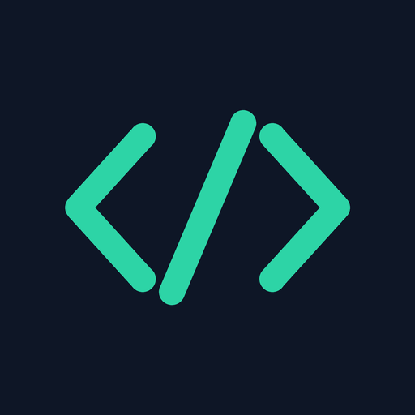
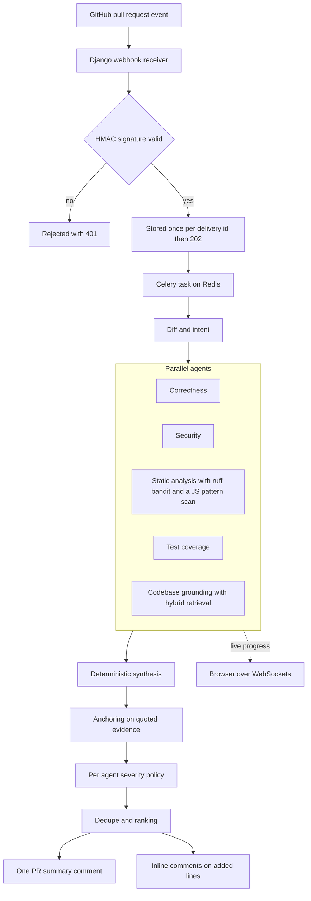
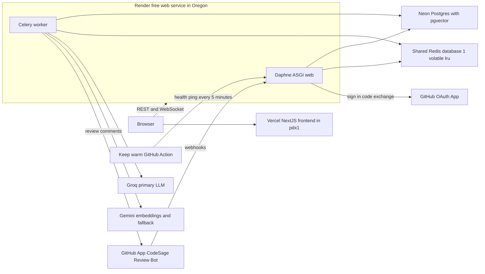

<p align="center"></p>

# CodeSage

AI code review for GitHub pull requests that knows your codebase, not just the diff.

[](https://github.com/NivedhReddy2048/CodeSage/actions/workflows/ci.yml)
[](LICENSE)
[](https://code-sage-lac.vercel.app)

Every pull request is reviewed by a LangGraph pipeline of six agents and a
deterministic synthesis step. Findings are grounded in the repository's own code
through hybrid retrieval, cite real files and lines, and arrive as one summary
comment plus inline comments on the lines the PR added.

## Live demo

**https://code-sage-lac.vercel.app**

Try it:

1. Sign in with GitHub.
2. Install the [CodeSage Review Bot](https://github.com/apps/codesage-review-bot) on one
   of your **public** repositories.
3. Open a pull request. The bot comments within seconds and edits the comment into
   the finished review.

| Free-demo limit | Value |
|---|---|
| Reviews per workspace per day | 5 (resets 00:00 UTC, 05:30 IST) |
| Reviews per day, all workspaces | 35 |
| Repositories per workspace | up to 3, public only |
| Indexed chunks per repository | 2,000 |
| Awake window | 08:00-24:00 IST |

Outside the awake window the backend sleeps. The first request wakes it in about a
minute, and pull requests opened while it slept are caught up when it wakes.

## How it works



- **Diff and intent** classifies the change first, so the other agents know what the
  PR is for.
- **Correctness** and **Security** run on `openai/gpt-oss-120b`. Diff and intent,
  grounding and test coverage run on `openai/gpt-oss-20b`. **Static analysis** runs
  real tools, `ruff` and `bandit`, on the head version of each changed Python file,
  and a pattern scan on JavaScript and TypeScript. It makes no model call.
- **Grounding** retrieves the most relevant existing code (pgvector cosine plus
  Postgres full-text, fused with reciprocal rank fusion), and a citation counts only
  if it supports the claim.
- **Synthesis** is deterministic code, not a model. It anchors each finding to the
  line its quoted evidence is on, applies the severity policy, merges duplicates and
  ranks blocking findings first.

## Features

- Six-agent review with a deterministic synthesis step, posted as one PR comment that
  is edited in place, never duplicated.
- Inline comments only on lines the PR added, one per line, capped at 15 per review.
- Live per-agent progress over WebSockets, with a polling fallback.
- Re-run a review from the UI, audited.
- Dashboard: PRs reviewed, findings per PR, latency and estimated cost, with trends.
- Review detail: the diff beside the findings, and what each agent did and which
  model served it.
- Workspaces with owner, admin and member roles, an append-only audit log, and
  notifications.
- Command palette, and light and dark themes.
- Honest degraded mode: if no model answers, the comment says the change was not
  reviewed.
- Missed webhooks are caught up after the service wakes, and interrupted reviews are
  re-queued once on startup.

## Tech stack

| Layer | Technology |
|---|---|
| Backend | Python 3.14, Django 6.1.1, Django REST Framework 3.18.1, Channels 4.3.2 on Daphne (ASGI), Celery 5.6.3, Simple JWT 5.5.1, drf-spectacular 0.30.0 |
| AI | LangGraph 1.2.16; Groq `openai/gpt-oss-120b` and `openai/gpt-oss-20b`; Gemini `gemini-embedding-001` (1536 dimensions) and `gemini-flash-lite-latest` as the fallback |
| Static analysis | ruff 0.16.8, bandit 1.9.4, a JS/TS pattern scan |
| Data | PostgreSQL 17 with pgvector (HNSW index) and full-text search; Redis for the Celery broker, Channels and the cache |
| Frontend | Next.js 16.3.5, React 19.2.8, TypeScript 5, Tailwind CSS 4, shadcn/ui on Base UI, lucide icons |
| Infra | Vercel (frontend), Render free web service (backend), Neon (Postgres), Render Key Value (Redis), GitHub Actions |
| CI | GitHub Actions on every PR: ruff, `manage.py check`, pytest with a 90% coverage gate; ESLint, Vitest and `next build`. Both checks are required to merge |
| Dev tooling | Docker Compose (pgvector/pgvector:pg17, redis:7-alpine), `scripts/dev.py`, smee-client 5.0.0 for local webhooks, pytest-django, Testing Library |

## Production architecture



- **One container, two processes.** Render's free tier has no background worker, so
  `backend/bin/start.sh` runs Daphne and one lean Celery worker side by side. If
  either exits, the other is stopped and Render restarts both; SIGTERM reaches both.
- **Shared Redis.** The account's single free Key Value (25 MB, 50 connections) is
  shared with another app. CodeSage uses database 1, prefixes every key, and the
  instance evicts only keys with a TTL (`volatile-lru`), so no Celery queue is ever
  evicted.
- **Neon only.** Production refuses to start without a `*.neon.tech` `DATABASE_URL`,
  or with `REDIS_URL` on database 0.

## Engineering highlights

- **Evidence-based anchoring.** Asked for line numbers, the models were off by one
  or two on every testbed PR. Agents now quote the line they mean, and the finding is
  anchored wherever that text actually is. Evidence found only on unchanged lines makes
  it a summary-only finding about existing code, never an inline comment
  (`backend/apps/agents/anchoring.py`).
- **Severity policy before merging.** On the testbed runs 73% of findings were
  blocking, and test coverage alone produced 27 of 38. A deterministic policy now
  runs before synthesis merges anything:
  - each agent stays in its domain;
  - test coverage is at most a nit;
  - blocking needs evidence quoted from an added line;
  - hedged wording ("may", "could") is a nit.

  An over-confident agent can no longer promote a merged group
  (`backend/apps/agents/policy.py`).
- **Citation verification.** A grounding citation must be in the same language
  family as the changed file and contain a symbol the message names, as a whole
  identifier. Retrieval's rank-1 hit for "function that looks up a user by id" was a
  JavaScript lookalike; it is no longer cited for a Python change.
- **Hybrid retrieval.** pgvector cosine plus Postgres full-text, fused with reciprocal
  rank fusion (k = 60), because cosine and `ts_rank` scores are not comparable.
  - The `simple` text-search config is used, not `english`, which drops `id` and
    `by` as stopwords.
  - Identifiers are indexed split as well as whole.
  - On the testbed, `find_by_id` moved from rank 5 to rank 2.
- **Webhooks that are never lost twice.** The HMAC is verified on the raw body, and
  every valid delivery is answered with 202 well inside GitHub's 10-second limit. A unique
  delivery id makes redelivery idempotent. Missed webhooks are caught up on worker
  startup and at most every 30 minutes: GitHub first, Redis second, and Postgres only
  for news, so a run where nothing changed makes zero database queries (tested). A
  review a restart interrupted is re-queued once per head commit, and audited.
- **Auth.** GitHub OAuth issues JWTs with a 30-minute access token and a 7-day
  refresh token. Refresh tokens are rotated and blacklisted after rotation, so a
  replayed one is refused and audited as "Session refresh rejected". The audit log
  records the real client IP, read from the right of X-Forwarded-For through three
  proxies (client, Cloudflare, Render's proxy). An address that is private or
  Cloudflare's is flagged as a misconfiguration.
- **Redis connection budget: 15 of 50.** Every client is capped per process, with a
  worst case of 14. A load test (20 concurrent webhooks, 10 WebSockets) peaked at
  **7** connections, 2 when idle. The first run peaked at 25: Django's cache handler
  is per thread, so the pool cap was per thread. One shared pool per process fixed it,
  and a test counts real connections on the server.
- **Free-tier engineering, ₹0 spend.** Costs are shown only as estimates at paid-tier
  rates.
  - **Render:** keep-warm runs 08:00-23:55 IST, about 501 of Render's 750 shared
    instance-hours a month.
  - **Neon:** connections close after every request or task. The health check never
    touches the database, and the notification bell stops polling when the tab is
    hidden or after 10 idle minutes.
  - **Neon compute-hours** are *estimated* (not yet measured) at ~3 a month idle,
    12-15 for light demo use and 70-100 for heavy use, against 100 free.
- **Windows-safe dev runner.** `scripts/dev.py` replaced honcho, which cannot stop
  its children on Windows. Each child gets its own process group, a graceful stop,
  then a tree kill after 8 seconds. A kill-on-close job object means nothing outlives
  the runner, and it refuses to start beside a stray Celery worker.
- **CI-gated PR workflow.** Every change since Phase 1 is an issue, a branch and a
  pull request merged with a merge commit, and only on green CI: branch protection
  requires both checks, admins included. **77 merged pull requests** so far.

## Evaluation

The question: does the multi-agent pipeline review better than a single prompt?
**Status: in progress. Results will be published in
[docs/EVALUATION.md](docs/EVALUATION.md).**

- **Dataset.** 50 cases from Python and JavaScript sources: BugsInPy, BugsJS, clean
  upstream commits and a purpose-built testbed.
  - DEV: 20 cases, 8 of them clean. It may be used for tuning.
  - TEST: 30 cases, 9 clean. TEST was sealed at commit `e4d42b9` before any DEV result
    existed, and runs once, at an `eval-freeze-*` tag.
- **Baseline.** One prompt to `openai/gpt-oss-120b`, the stronger model, while most
  pipeline agents use `gpt-oss-20b`. It gets the same diff, anchoring and severity
  post-processing, but no agents, retrieval or linters.
- **Scoring.** A bug is caught when a finding is in the same file, within ±2 lines,
  and of an accepted category; a finding credits at most one bug. Every rate is k/n
  with a 95% Wilson interval. Cases are run more than once (three times in DEV round
  2), and a bug counts as caught when most of its valid runs catch it.
- **No-fallback rule.** A run where any model-backed agent failed or fell back is
  invalid: retried, then excluded and counted.
- **Licences.** Each fixture keeps its project's licence, credited in
  [THIRD_PARTY_NOTICES.md](THIRD_PARTY_NOTICES.md). GPL projects are excluded.

The harness is `manage.py run_eval`; see [eval/README.md](eval/README.md).

## Local development

Prerequisites: Docker Desktop, Python 3.14 and Node 24 (what CI runs).

```bash
# Once: install dependencies and copy the env files
cd backend && python -m venv .venv && .venv/Scripts/pip install -r requirements-dev.txt
cp .env.example .env && .venv/Scripts/python manage.py migrate && cd ..
cd frontend && npm ci && cp .env.local.example .env.local && cd ..

# Every time, from the repository root
docker compose up -d           # Postgres with pgvector, and Redis
python scripts/dev.py          # backend :8000, Celery worker, frontend :3000, webhook relay
                               # Ctrl+C stops everything
python scripts/dev.py stop     # kills leftovers from a crashed session
```

Use `.venv/bin/` instead of `.venv/Scripts/` outside Windows. Configuration:
[backend/.env.example](backend/.env.example) and
[frontend/.env.local.example](frontend/.env.local.example). The local OAuth App, the
GitHub App, receiving webhooks on localhost and the operator commands are in
[docs/DEVELOPMENT.md](docs/DEVELOPMENT.md).

## Deployment

Production runs entirely on free tiers:
- Vercel for the frontend;
- one Render free web service for Daphne and the Celery worker;
- Neon for Postgres with pgvector;
- a shared Render Key Value for Redis;
- a GitHub Actions keep-warm ping.

[docs/DEPLOY.md](docs/DEPLOY.md) covers everything in setup order, with environment
variable names only: the GitHub OAuth App and GitHub App, the connection budget, the
monthly limits to watch, and the lessons from the first deploy.

## Project structure

```
backend/
  apps/          accounts, repos, ingestion, agents, reviews, notifications,
                 analytics, audit, evaluation
  core/          settings, ASGI, Celery, health
  bin/           Render build and start scripts
  tests/
frontend/src/    Next.js app routes, components, hooks, API client
eval/            cases (dev, test), cached results, fixture builders
docs/            spec, progress, deploy, development, evaluation
scripts/dev.py   the local dev runner
.github/         CI and keep-warm workflows
```

## Known limitations

- **Cold starts.** The backend sleeps outside 08:00-24:00 IST, and on any quiet
  spell of 15 minutes. The first request then waits about a minute. Webhooks sent
  while it sleeps are lost by GitHub and recovered by the catch-up, so those reviews
  arrive late.
- **Static analysis depth.** Real linters (ruff, bandit) run only on Python.
  JavaScript and TypeScript get a pattern scan, and other languages get the LLM agents
  only.
- **LLM variance.** The same PR can get different findings on different runs. The
  evaluation runs each case three times to measure this; the results are not
  published yet.
- **Demo scope.** Public repositories only, up to 3 per workspace, and 5 reviews a
  day per workspace, all on shared free-tier quotas.
- **The evaluation is not finished.** No quality figures are claimed until
  [docs/EVALUATION.md](docs/EVALUATION.md) has them.

## License

[MIT](LICENSE). Evaluation fixtures keep their own licences
([THIRD_PARTY_NOTICES.md](THIRD_PARTY_NOTICES.md)).
